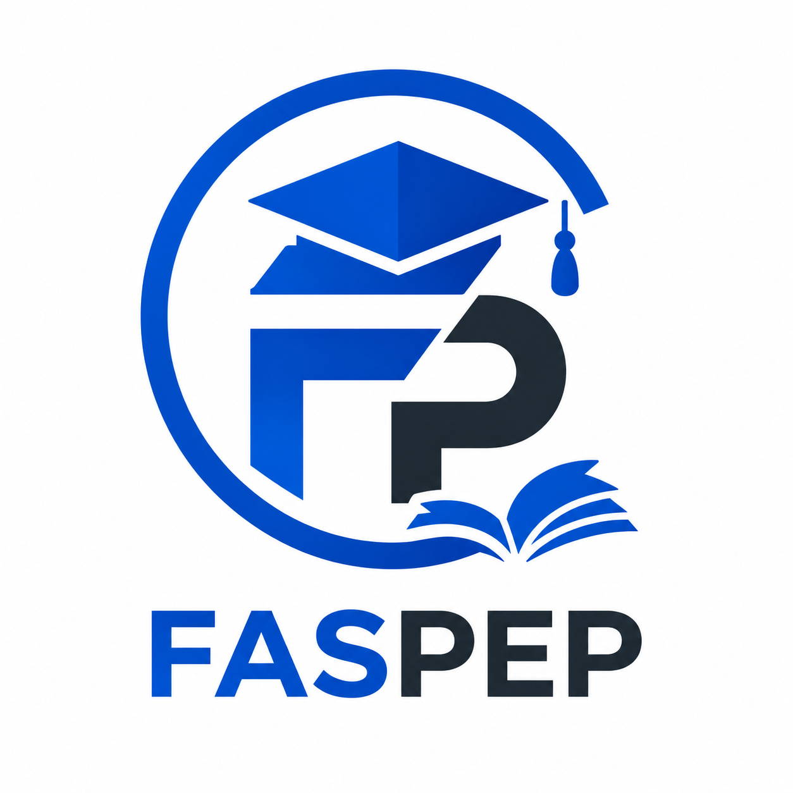

  

FASPEP

**Digital Examinations and Assessment**

**Making digital examinations feel familiar.**

FASPEP is a digital examination and assessment platform being developed by FASRED Technologies Ltd. to help educational institutions and other assessment organisations manage the examination lifecycle while making the candidate experience more familiar to people accustomed to paper, pen and pencil.

The goal is not simply to put questions on a screen. It is to make the transition to digital assessment practical for candidates, educators, examiners and administrators.

**Product status:** In development. Release planned by December 2026.

**Official website:** https://fasredtech.com

**Product enquiries and demonstration requests:**  
https://fasredtech.com/contact?inquiry=sales&intent=demo

---

## The problem FASPEP addresses

Moving examinations to computers can introduce challenges beyond the questions themselves. Candidates may need to adapt to unfamiliar interfaces, while institutions must coordinate examination preparation, candidate registration, assessment delivery, marking, result approval and academic records.

FASPEP is being developed to address this wider process through a connected assessment experience.

Our guiding principle is simple:

**Technology should adapt to the examination, not force the examination to adapt to technological limitations.**

## Product direction

FASPEP is being developed around five areas.

### 1. Examination preparation

Support the preparation and organisation of examinations, including assessment structures, questions, papers, instructions, schedules and marking requirements.

### 2. Familiar candidate experience

Work towards a digital examination experience that supports the different ways candidates engage with questions, including objective questions, written responses, calculations, mathematical expressions, diagrams and other subject-specific assessment tasks.

### 3. Examination administration

Support the workflows involved in candidate participation, examination sessions, supervision, submission and the management of examination incidents.

### 4. Marking and results

Support the intended assessment process from scoring and marking through moderation, result review, approval and publication.

### 5. Academic records

Support the broader lifecycle of assessment outcomes, including report cards, historical results, academic progression, transcripts and credential workflows, as applicable to the institution and its requirements.

These areas describe the product's intended scope; individual capabilities will become available as development, testing and release activities progress.

## Who FASPEP is being developed for

Our intended customer groups include:

- Private schools, school groups and educational institutions.
- Creche, kindergarten, nursery, primary and secondary education providers.
- Universities, polytechnics and colleges of education.
- Examination and assessment organisations.
- Employers and organisations conducting recruitment or competency assessments.
- Professional and technical training providers.

Different organisations have different academic structures, assessment policies and operational requirements. FASPEP's product direction is designed to account for those differences.

## The assessment lifecycle

FASPEP's intended scope extends across the following stages:

1. Organisation setup and assessment configuration.
2. Examination planning and question preparation.
3. Review, quality assurance and approval.
4. Candidate registration, eligibility and scheduling.
5. Examination delivery and candidate responses.
6. Submission and examination closure.
7. Automatic scoring and manual marking, as applicable.
8. Moderation and result approval.
9. Result publication and feedback.
10. Academic records, progression and authorised credentials.
11. Corrections, appeals, retention and historical reporting.

The applicable workflow will depend on the institution, assessment type and relevant policies.

## Our approach

FASPEP is being developed with attention to:

- Familiarity and ease of use.
- Reliable examination workflows and answer handling.
- Accessibility and supported devices.
- Assessment integrity and accountable administration.
- Appropriate access control and protection of information.
- Clear operational processes for candidates and administrators.
- Verification through testing and practical use.

These are product and engineering priorities, not claims that every requirement has already been completed or independently certified.

## Interested in FASPEP?

We welcome enquiries from schools, educational institutions and organisations interested in evaluating digital assessment solutions.

Contact FASRED Technologies Ltd. to discuss your assessment needs, request a product demonstration or explore a potential pilot.

**Request a discussion or demonstration:**  
https://fasredtech.com/contact?inquiry=sales&intent=demo

**Explore FASRED Technologies:**  
https://fasredtech.com

---
## Documentation

- [Examination Lifecycle](docs/EXAMINATION_LIFECYCLE.md) — Explore the intended examination workflow, from planning to records and appeals.
- [Frequently Asked Questions](docs/FAQ.md) — Answers to common questions about FASPEP, its intended users and product availability.
- [Product Roadmap](docs/PRODUCT_ROADMAP.md) — Review FASPEP's product priorities and development direction.
  
## Ownership and intellectual property

FASPEP is a proprietary product of FASRED Technologies Ltd.

This repository provides public product information only. It does not contain the FASPEP application source code or grant permission to reproduce, distribute, modify or commercially exploit the product.

Unless expressly stated otherwise, all rights in the product name, branding, software and proprietary materials are reserved by their respective rights holder.

© 2026 FASRED Technologies Ltd. All rights reserved.

**Technology Engineered for Impact.**
